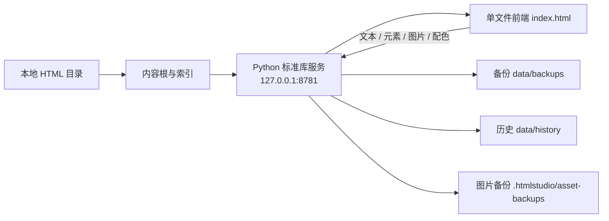

<div align="center">

# HTML 工作台 · HTML Studio

**把 AI 生成的 HTML 收进来，点哪里改哪里。**

改文案 · 局部样式 · 换图片 · 调元素 · 改配色 · 版本回滚 —— 零依赖，只跑在你自己电脑上。


[简体中文](#简体中文) · [English](#english) · [日本語](#日本語)

</div>

---

## 简体中文

### 为什么需要它

AI 生成一个页面只要几十秒，改一个错别字却常常要重开一轮对话：

1. **改一个字，重写整页。** 让模型“只改这一句”，它经常顺手把布局、配色和别的段落一起改了，越改越不像原来的东西。
2. **想换一张图，得先拆 DOM。** 图片、按钮、卡片都藏在源码里，不知道对应哪一段；替换文件后还要担心路径和缓存。
3. **改坏了回不去。** 没有备份和历史，一次误操作只能从头生成。

HTML 工作台把这三件事收拢到一个本地页面：**收录 → 预览 → 就地改 → 自动备份 → 随时回滚**。它不重新生成页面，只精确修改你已经满意的那一版。

### 它是什么

一个本地运行的 HTML 可视化编辑器：

- 后端是单个 Python 脚本，**只用标准库**，没有 pip 依赖；
- 前端是单文件 `index.html`，不依赖任何 CDN，离线可用；
- 默认只监听 `127.0.0.1:8781`，不对外网开放；
- 直接读写你磁盘上的 HTML 文件，不搬家、不上传、不调用外部 API；
- 所有写操作先备份，再改文件，并留下版本历史。

它不替代 AI，也不替代编辑器，只负责把“已经生成好的页面”改到能交付。

### 功能

| 能力 | 说明 |
| --- | --- |
| 收录与索引 | 添加任意本地目录作为内容根，自动索引其中的 HTML；支持搜索、排序、封面、置顶 |
| 文本编辑 | 按段落 / 标题逐块修改文案，不用碰标签 |
| 局部文字样式 | 在预览里选中一小段文字，浮条改颜色、加粗、斜体、下划线、字号，只影响选中的字 |
| 元素编辑 | 选中图片、链接、按钮、卡片，修改图片地址、链接目标、尺寸、对齐、圆角、内外边距、最大宽度 |
| 图片替换 | 列出页面用到的全部图片（含脚本动态切换的图），缩略图预览，原地替换，旧图自动备份 |
| 配色 | 读取并修改页面 CSS 变量，实时预览；内置配色卡，可保存、复用、移除注入 |
| 多设备预览 | 自适应 / 电脑 / 平板 / 手机，内置 MacBook、iPad、iPhone、Android 常用视口 |
| 预览内编辑 | 单击定位元素，双击直接改文本；点选后自动高亮对应源码位置 |
| 交接说明 | 选目标与待办，生成一段可直接交给 AI 的 Markdown 修改说明 |
| 版本与回滚 | 每次写入生成历史版本，可看差异、一键恢复；另有独立备份目录 |
| 导出 | 导出当前页 PDF / PNG，或把选中的多个页面打包成 zip |
| 三语与主题 | 简体中文 / English / 日本語，浅色 / 深色两套界面 |

### 五个工作区

| 页签 | 用来做什么 |
| --- | --- |
| 文本 | 按块改文案；适合大段文字和标题层级调整 |
| 元素 | 改图片、链接、按钮和卡片的属性与盒模型；可换图、可点选 |
| 配色 | 调 CSS 变量与内置配色卡，实时预览后再应用 |
| 交接 | 生成 Markdown 交接说明，告诉下一个 AI 或同事“还要改什么” |
| 版本 | 查看历史版本、差异对比、恢复与备份管理 |

### 工作流程

1. **收录**：添加存 HTML 的文件夹，左侧出现页面列表。
2. **选中**：中间是实时预览，可切换设备尺寸；右侧是编辑面板。
3. **修改**：改文案、选字调样式、点选元素、替换图片、调配色。
4. **应用**：改动先进入草稿，点「应用」才写入文件；写入前自动备份。
5. **回滚**：在「版本」里看差异，随时恢复到之前的状态。

### 快速开始

只需要 Python 3.9+，不需要安装任何第三方包：

```bash
git clone https://github.com/Alksay2002/html-studio.git
cd html-studio
python htmlstudio_server.py
```

浏览器会自动打开 `http://127.0.0.1:8781/`。首次使用点左上角「添加目录」，选择存放 HTML 的文件夹即可。

常用参数：

| 参数 | 作用 |
| --- | --- |
| `--port 9000` | 换端口，默认 `8781` |
| `--host 0.0.0.0` | 允许局域网访问（默认仅本机；开放前请确认网络环境） |
| `--list` | 只打印已收录页面后退出 |
| `--no-browser` | 启动时不自动打开浏览器 |

### 图片为什么有时只显示一张？

页面里只写了一个 ``，其余图片由脚本在运行时替换（常见于作品集、轮播、切换预览）。元素扫描只认真实 DOM，所以「图片」里只出现一张是正常的。

这时用「元素 → 图片资源」：它会把 HTML、JS、CSS 里引用到的图片，以及同目录下的图片文件一起列出来，并允许逐张替换。替换是原地覆盖，旧图会存到页面目录下的 `.htmlstudio/asset-backups/`。

### 数据与备份

| 内容 | 位置 |
| --- | --- |
| 配置、索引、配色卡 | `data/`（打包运行时为 `%APPDATA%\HTMLStudio\data`） |
| 页面备份 | `data/backups/` |
| 版本历史 | `data/history/` |
| 图片替换备份 | 页面目录下的 `.htmlstudio/asset-backups/` |
| 导出缓存 | `data/exports/` |

存储位置可在「设置 → 存储」里切换：集中放在数据目录，或跟随页面放在旁边。

### 安全边界

- 服务默认只绑定 `127.0.0.1`，不监听公网。
- 所有读写都限制在已添加的内容根内；`..` 只有在解析后仍位于根内时才允许。
- 图片替换只接受同格式图片，写入前校验目标必须是已存在的图片文件。
- 不收集、不上报任何数据；PDF / PNG 导出调用本机已安装的 Edge / Chrome，不联网。

### 常见问题

**修改或应用失败？**
页面文件可能被其他程序占用、被设为只读，或路径已不在内容根内。先刷新页面再试；失败不会破坏原文件，备份仍在。

**缩略图或预览里的图片不显示？**
先确认图片确实在内容根内。0.1.0 已修复相对路径（如 `../assets/...`）被拒绝的问题。

**能直接改线上网站吗？**
不能。它只处理本地文件；要改线上页面，先把文件拉下来。

**会替代 AI 生成页面吗？**
不会。它只改你已经满意的那一版，避免让模型重写整页。

**端口被占用？**
用 `--port` 换一个端口。

### 架构



```
html-studio/
├─ htmlstudio_server.py   # 本地服务：索引、编辑、备份、配色、导出
├─ index.html             # 单文件前端：三语 / 明暗 / 预览 / 编辑面板
├─ assets/                # 图标
├─ app.config.json        # 可选：Windows 安装包配置
├─ LICENSE
└─ README.md
```

### 打包为 Windows 程序（可选）

```bash
pip install pyinstaller
pyinstaller --noconfirm --onefile --name HTMLStudio --noconsole ^
  --add-data "index.html;." --add-data "assets;assets" htmlstudio_server.py
```

需要安装向导时，可基于 `app.config.json` 用 Inno Setup 生成安装包；打包后数据目录会自动切到 `%APPDATA%\HTMLStudio\data`。

### 路线图

- 更多元素类型：表格、列表、表单控件
- 批量图片替换与图片压缩
- 局部样式的撤销 / 重做
- 更多内置配色与一键换肤

### 贡献

欢迎 Issue 和 PR。提交前请确认：

- 不包含个人路径、密钥、Token 或私有页面内容；
- 保持零第三方运行时依赖；
- 界面文案在中 / 英 / 日三语中同步更新。

### License

[MIT](LICENSE) © 2026 凌空 (Lingkong)

如果这个工具帮你省下了重开对话的时间，点个 Star 就是最好的支持。


---

<a id="english"></a>

## English

### Why

Generating a page with AI takes seconds; fixing one typo usually costs another round of prompting — and the model often rewrites layout and colors along the way. HTML Studio is a local visual editor for the page you already like: **index → preview → edit in place → auto-backup → roll back**.

### What it is

- A single Python script using **only the standard library** — no pip install.
- A single-file frontend with **no CDN**, fully offline.
- Binds to `127.0.0.1:8781` by default.
- Edits files on your disk directly; nothing is uploaded.

### Features

| Capability | Description |
| --- | --- |
| Index & search | Add any local folder as a content root; search, sort, cover, pin |
| Text editing | Rewrite copy block by block without touching markup |
| Inline styles | Select a few words to change color, bold, italic, underline, size |
| Element editing | Images, links, buttons, cards: src, href, size, radius, spacing, max-width |
| Image replacement | Every image, including script-swapped ones, with thumbnails and automatic backups |
| Palette | Edit CSS variables with live preview; built-in palettes; save or remove injection |
| Device preview | Auto / desktop / tablet / phone with real viewport presets |
| Live edit | Click to locate an element, double-click to edit its text |
| Handoff | Generate a Markdown brief for the next AI or teammate |
| History | Diff, restore, and independent backups for every write |
| Export | PDF / PNG of the current page, or a zip of selected pages |
| i18n & themes | Chinese / English / Japanese, light and dark |

### Quick start

```bash
git clone https://github.com/Alksay2002/html-studio.git
cd html-studio
python htmlstudio_server.py
```

Open <http://127.0.0.1:8781/>, click “Add folder”, and pick the directory that holds your HTML files.

Options: `--port`, `--host`, `--list`, `--no-browser`.

### Safety

- Localhost only by default; no telemetry, no external API calls.
- Every read/write is confined to the content roots you added.
- Image replacement accepts the same format only and keeps the old file under `.htmlstudio/asset-backups/`.
- PDF / PNG export uses your installed Edge or Chrome locally.

### FAQ

**Only one image is listed.** The page may contain a single `` and swap images with JavaScript. Use “Element → Image assets” to see every referenced file.

**A change failed to apply.** The file may be locked, read-only, or outside the content root. Refresh and retry; the original file is never lost.

**Does it rewrite my page with AI?** No. It only edits the version you already approved.

### License

[MIT](LICENSE) © 2026 Lingkong

---

<a id="日本語"></a>

## 日本語

### なぜ必要か

AI でページを作るのは数十秒、誤字を直すのにもう一度プロンプトを打つ——しかもレイアウトや配色まで書き換えられがちです。HTML Studio は、**すでに気に入っているページ**をローカルでそのまま編集するためのツールです。

### 特徴

- Python 標準ライブラリのみの単一スクリプト。追加インストール不要。
- 単一ファイルのフロントエンド。CDN 不使用、オフラインで動作。
- 既定では `127.0.0.1:8781` のみで待ち受け。
- ディスク上の HTML を直接編集。アップロードなし、外部 API なし。

### できること

| 機能 | 内容 |
| --- | --- |
| 取り込みと索引 | ローカルフォルダを追加し、HTML を自動索引。検索・並べ替え・表紙・ピン留め |
| テキスト編集 | 段落・見出し単位で文章を修正 |
| 部分スタイル | 選択した数文字だけ色・太字・斜体・下線・文字サイズを変更 |
| 要素編集 | 画像・リンク・ボタン・カードの属性、サイズ、角丸、余白、最大幅 |
| 画像置換 | スクリプトで切り替わる画像も含めて一覧表示し、その場で置換。旧画像は自動バックアップ |
| 配色 | CSS 変数をライブプレビューしながら調整。配色プリセットの保存・適用・解除 |
| 端末プレビュー | 自動 / PC / タブレット / スマートフォン、実機相当のビューポート |
| プレビュー編集 | クリックで要素を特定、ダブルクリックでテキストを直接編集 |
| 引き継ぎ | 次の AI や担当者向けの Markdown 指示を生成 |
| 履歴 | 差分表示・復元・独立バックアップ |
| 書き出し | 現在のページを PDF / PNG、選択ページを zip に |
| 三言語・テーマ | 中文 / English / 日本語、ライト・ダーク |

### はじめ方

```bash
git clone https://github.com/Alksay2002/html-studio.git
cd html-studio
python htmlstudio_server.py
```

<http://127.0.0.1:8781/> を開き、「フォルダを追加」から HTML のあるディレクトリを選びます。

オプション：`--port` / `--host` / `--list` / `--no-browser`。

### 安全について

- 既定ではローカルのみ。テレメトリも外部 API もありません。
- 読み書きは追加したコンテンツルート内に限定されます。
- 画像置換は同じ形式のみ。旧ファイルは `.htmlstudio/asset-backups/` に保存されます。

### ライセンス

[MIT](LICENSE) © 2026 Lingkong
