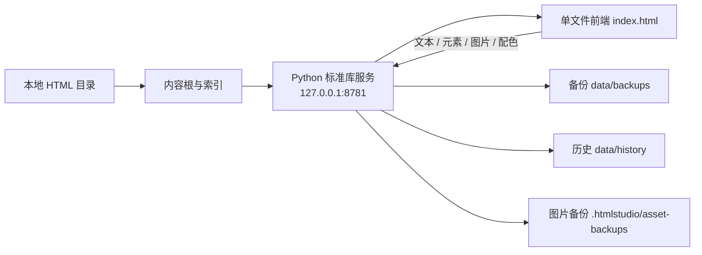
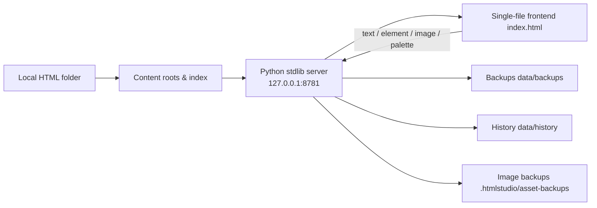
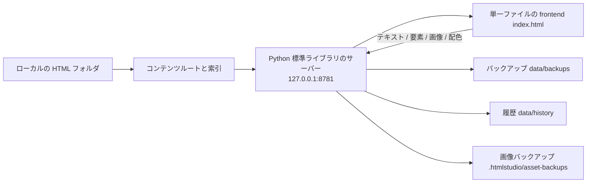

<div align="center">

# HTML 工作台 · HTML Studio

**把 AI 生成的 HTML 收进来，点哪里改哪里。**

改文案 · 局部样式 · 换图片 · 调元素 · 改配色 · 版本回滚 —— 零依赖，只跑在你自己电脑上。


[简体中文](#简体中文) · [English](#english) · [日本語](#日本語)

</div>

---

## 简体中文

### 为什么需要它

AI 生成一个页面只要几十秒，改一个错别字却常常要重开一轮对话：

1. **改一个字，重写整页。** 让模型“只改这一句”，它经常顺手把布局、配色和别的段落一起改了，越改越不像原来的东西。
2. **想换一张图，得先拆 DOM。** 图片、按钮、卡片都藏在源码里，不知道对应哪一段；替换文件后还要担心路径和缓存。
3. **改坏了回不去。** 没有备份和历史，一次误操作只能从头生成。

HTML 工作台把这三件事收拢到一个本地页面：**收录 → 预览 → 就地改 → 自动备份 → 随时回滚**。它不重新生成页面，只精确修改你已经满意的那一版。

### 它是什么

一个本地运行的 HTML 可视化编辑器：

- 后端是单个 Python 脚本，**只用标准库**，没有 pip 依赖；
- 前端是单文件 `index.html`，不依赖任何 CDN，离线可用；
- 默认只监听 `127.0.0.1:8781`，不对外网开放；
- 直接读写你磁盘上的 HTML 文件，不搬家、不上传、不调用外部 API；
- 所有写操作先备份，再改文件，并留下版本历史。

它不替代 AI，也不替代编辑器，只负责把“已经生成好的页面”改到能交付。

### 功能

| 能力 | 说明 |
| --- | --- |
| 收录与索引 | 添加任意本地目录作为内容根，自动索引其中的 HTML；支持搜索、排序、封面、置顶 |
| 文本编辑 | 按段落 / 标题逐块修改文案，不用碰标签 |
| 局部文字样式 | 在预览里选中一小段文字，浮条改颜色、加粗、斜体、下划线、字号，只影响选中的字 |
| 元素编辑 | 选中图片、链接、按钮、卡片，修改图片地址、链接目标、尺寸、对齐、圆角、内外边距、最大宽度 |
| 图片替换 | 列出页面用到的全部图片（含脚本动态切换的图），缩略图预览，原地替换，旧图自动备份 |
| 配色 | 读取并修改页面 CSS 变量，实时预览；内置配色卡，可保存、复用、移除注入 |
| 多设备预览 | 自适应 / 电脑 / 平板 / 手机，内置 MacBook、iPad、iPhone、Android 常用视口 |
| 预览内编辑 | 单击定位元素，双击直接改文本；点选后自动高亮对应源码位置 |
| 交接说明 | 选目标与待办，生成一段可直接交给 AI 的 Markdown 修改说明 |
| 版本与回滚 | 每次写入生成历史版本，可看差异、一键恢复；另有独立备份目录 |
| 导出 | 导出当前页 PDF / PNG，或把选中的多个页面打包成 zip |
| 三语与主题 | 简体中文 / English / 日本語，浅色 / 深色两套界面 |

### 五个工作区

| 页签 | 用来做什么 |
| --- | --- |
| 文本 | 按块改文案；适合大段文字和标题层级调整 |
| 元素 | 改图片、链接、按钮和卡片的属性与盒模型；可换图、可点选 |
| 配色 | 调 CSS 变量与内置配色卡，实时预览后再应用 |
| 交接 | 生成 Markdown 交接说明，告诉下一个 AI 或同事“还要改什么” |
| 版本 | 查看历史版本、差异对比、恢复与备份管理 |

### 工作流程

1. **收录**：添加存 HTML 的文件夹，左侧出现页面列表。
2. **选中**：中间是实时预览，可切换设备尺寸；右侧是编辑面板。
3. **修改**：改文案、选字调样式、点选元素、替换图片、调配色。
4. **应用**：改动先进入草稿，点「应用」才写入文件；写入前自动备份。
5. **回滚**：在「版本」里看差异，随时恢复到之前的状态。

### 快速开始

只需要 Python 3.9+，不需要安装任何第三方包：

```bash
git clone https://github.com/Alksay2002/html-studio.git
cd html-studio
python htmlstudio_server.py
```

浏览器会自动打开 `http://127.0.0.1:8781/`。首次使用点左上角「添加目录」，选择存放 HTML 的文件夹即可。

常用参数：

| 参数 | 作用 |
| --- | --- |
| `--port 9000` | 换端口，默认 `8781` |
| `--host 0.0.0.0` | 允许局域网访问（默认仅本机；开放前请确认网络环境） |
| `--list` | 只打印已收录页面后退出 |
| `--no-browser` | 启动时不自动打开浏览器 |

### 图片为什么有时只显示一张？

页面里只写了一个 ``，其余图片由脚本在运行时替换（常见于作品集、轮播、切换预览）。元素扫描只认真实 DOM，所以「图片」里只出现一张是正常的。

这时用「元素 → 图片资源」：它会把 HTML、JS、CSS 里引用到的图片，以及同目录下的图片文件一起列出来，并允许逐张替换。替换是原地覆盖，旧图会存到页面目录下的 `.htmlstudio/asset-backups/`。

### 数据与备份

| 内容 | 位置 |
| --- | --- |
| 配置、索引、配色卡 | `data/`（打包运行时为 `%APPDATA%\HTMLStudio\data`） |
| 页面备份 | `data/backups/` |
| 版本历史 | `data/history/` |
| 图片替换备份 | 页面目录下的 `.htmlstudio/asset-backups/` |
| 导出缓存 | `data/exports/` |

存储位置可在「设置 → 存储」里切换：集中放在数据目录，或跟随页面放在旁边。

### 安全边界

- 服务默认只绑定 `127.0.0.1`，不监听公网。
- 所有读写都限制在已添加的内容根内；`..` 只有在解析后仍位于根内时才允许。
- 图片替换只接受同格式图片，写入前校验目标必须是已存在的图片文件。
- 不收集、不上报任何数据；PDF / PNG 导出调用本机已安装的 Edge / Chrome，不联网。

### 常见问题

**修改或应用失败？**
页面文件可能被其他程序占用、被设为只读，或路径已不在内容根内。先刷新页面再试；失败不会破坏原文件，备份仍在。

**缩略图或预览里的图片不显示？**
先确认图片确实在内容根内。0.1.0 已修复相对路径（如 `../assets/...`）被拒绝的问题。

**能直接改线上网站吗？**
不能。它只处理本地文件；要改线上页面，先把文件拉下来。

**会替代 AI 生成页面吗？**
不会。它只改你已经满意的那一版，避免让模型重写整页。

**端口被占用？**
用 `--port` 换一个端口。

### 架构



```
html-studio/
├─ htmlstudio_server.py   # 本地服务：索引、编辑、备份、配色、导出
├─ index.html             # 单文件前端：三语 / 明暗 / 预览 / 编辑面板
├─ assets/                # 图标
├─ app.config.json        # 可选：Windows 安装包配置
├─ LICENSE
└─ README.md
```

### 打包为 Windows 程序（可选）

```bash
pip install pyinstaller
pyinstaller --noconfirm --onefile --name HTMLStudio --noconsole ^
  --add-data "index.html;." --add-data "assets;assets" htmlstudio_server.py
```

需要安装向导时，可基于 `app.config.json` 用 Inno Setup 生成安装包；打包后数据目录会自动切到 `%APPDATA%\HTMLStudio\data`。

### 路线图

- 更多元素类型：表格、列表、表单控件
- 批量图片替换与图片压缩
- 局部样式的撤销 / 重做
- 更多内置配色与一键换肤

### 贡献

欢迎 Issue 和 PR。提交前请确认：

- 不包含个人路径、密钥、Token 或私有页面内容；
- 保持零第三方运行时依赖；
- 界面文案在中 / 英 / 日三语中同步更新。

### 许可

[MIT](LICENSE) © 2026 凌空 (Lingkong)

如果这个工具帮你省下了重开对话的时间，点个 Star 就是最好的支持。


---

<a id="english"></a>

## English

### Why this exists

Generating a page with AI takes seconds. Fixing one typo usually costs another round of prompting — and the model often rewrites the layout, the colors, and a few unrelated paragraphs along the way.

1. **One word, whole page rewritten.** Ask for “just this sentence” and you get a different design back.
2. **Changing an image means digging into the DOM.** Images, buttons and cards are buried in markup, and after replacing a file you still have to worry about paths and caching.
3. **No way back.** Without backups or history, one wrong click means regenerating from scratch.

HTML Studio collapses this into one local page: **index → preview → edit in place → auto-backup → roll back**. It never regenerates your page; it edits the version you already approved.

### What it is

A local visual editor for HTML pages:

- The backend is a single Python script using **only the standard library** — no pip dependencies.
- The frontend is a single `index.html` — no CDN, fully offline.
- It binds to `127.0.0.1:8781` by default and never exposes itself to the internet.
- It reads and writes the HTML files already on your disk: no migration, no upload, no external API.
- Every write is backed up first, and every change leaves a version in history.

It does not replace AI or your code editor. It only takes the page you generated and gets it ready to ship.

### Features

| Capability | Description |
| --- | --- |
| Index & search | Add any local folder as a content root; automatic indexing, search, sorting, covers, pinning |
| Text editing | Rewrite copy block by block without touching markup |
| Inline text styles | Select a few words to change color, bold, italic, underline or font size — only the selection changes |
| Element editing | Images, links, buttons and cards: src, href, size, alignment, radius, padding, margin, max-width |
| Image replacement | Lists every image the page uses (including script-swapped ones), with thumbnails, in-place replacement and automatic backups |
| Palette | Read and edit CSS variables with live preview; built-in palettes; save, apply, or remove the injected style |
| Device preview | Auto / desktop / tablet / phone, with real presets for MacBook, iPad, iPhone and Android |
| Live edit | Click to locate an element, double-click to edit its text; selections highlight the matching source |
| Handoff | Pick goals and tasks, then generate a Markdown brief for the next AI or teammate |
| History & rollback | Every write becomes a version; diff, restore, plus an independent backup directory |
| Export | PDF / PNG of the current page, or a zip of selected pages |
| Languages & themes | Chinese / English / Japanese, light and dark |

### Five workspaces

| Tab | What it is for |
| --- | --- |
| Text | Edit copy block by block; best for long passages and heading structure |
| Element | Edit the attributes and box model of images, links, buttons and cards; replace images; pick from the preview |
| Palette | Tune CSS variables and built-in palettes with live preview before applying |
| Handoff | Generate a Markdown brief telling the next AI or colleague what still needs work |
| Version | Browse history, compare diffs, restore, and manage backups |

### Workflow

1. **Index** — add the folder that holds your HTML; the page list appears on the left.
2. **Select** — the live preview sits in the middle with device switching; the editor panel is on the right.
3. **Edit** — change copy, style a text selection, click elements, replace images, adjust the palette.
4. **Apply** — edits stay as a draft until you press Apply; the file is backed up right before writing.
5. **Roll back** — review diffs under Version and restore any earlier state at any time.

### Quick start

All you need is Python 3.9+. No third-party packages:

```bash
git clone https://github.com/Alksay2002/html-studio.git
cd html-studio
python htmlstudio_server.py
```

Your browser opens `http://127.0.0.1:8781/` automatically. Click “Add folder” in the top-left corner and choose the directory that contains your HTML files.

Common options:

| Option | Effect |
| --- | --- |
| `--port 9000` | Use another port (default `8781`) |
| `--host 0.0.0.0` | Allow LAN access (localhost only by default; check your network first) |
| `--list` | Print indexed pages and exit |
| `--no-browser` | Do not open a browser on start |

### Why is only one image listed?

The page may contain a single `` while the rest are swapped at runtime by JavaScript (common in portfolios, carousels and preview switchers). Element scanning only reports the real DOM, so one image is expected.

Use **Element → Image assets** instead: it lists images referenced from HTML, JS and CSS plus sibling image files in those directories, and lets you replace them one by one. Replacement overwrites in place and keeps the old file under `.htmlstudio/asset-backups/` next to the page.

### Data and backups

| Content | Location |
| --- | --- |
| Config, index, palettes | `data/` (`%APPDATA%\HTMLStudio\data` when packaged) |
| Page backups | `data/backups/` |
| Version history | `data/history/` |
| Image replacement backups | `.htmlstudio/asset-backups/` next to the page |
| Export cache | `data/exports/` |

Storage can be switched under **Settings → Storage**: keep everything in the data directory, or store it beside the page.

### Safety boundaries

- The server binds to `127.0.0.1` by default and never listens publicly.
- Every read and write is confined to the content roots you added; `..` is allowed only when the resolved path stays inside a root.
- Image replacement accepts the same format only and verifies the target is an existing image before writing.
- No telemetry, no uploads. PDF / PNG export uses your locally installed Edge or Chrome and makes no network calls.

### FAQ

**A change failed to apply.**
The file may be locked by another program, marked read-only, or no longer inside a content root. Refresh and retry; a failed write never damages the original, and backups remain.

**Thumbnails or preview images do not show.**
Make sure the file really is inside a content root. Version 0.1.0 fixed relative paths such as `../assets/...` being rejected.

**Can it edit a live website?**
No. It only works on local files; download the page first.

**Does it replace AI generation?**
No. It edits the version you already approved so the model does not rewrite everything.

**The port is taken.**
Start it with `--port` and pick another one.

### Architecture



```
html-studio/
├─ htmlstudio_server.py   # Local server: index, editing, backups, palette, export
├─ index.html             # Single-file frontend: i18n, themes, preview, panels
├─ assets/                # Icons
├─ app.config.json        # Optional: Windows installer config
├─ LICENSE
└─ README.md
```

### Build a Windows app (optional)

```bash
pip install pyinstaller
pyinstaller --noconfirm --onefile --name HTMLStudio --noconsole ^
  --add-data "index.html;." --add-data "assets;assets" htmlstudio_server.py
```

For an installer wizard, use Inno Setup with `app.config.json`. A packaged build automatically stores its data in `%APPDATA%\HTMLStudio\data`.

### Roadmap

- More element types: tables, lists, form controls
- Batch image replacement and compression
- Undo / redo for inline styles
- More built-in palettes and one-click theming

### Contributing

Issues and pull requests are welcome. Before submitting, please make sure:

- No personal paths, keys, tokens, or private page content are included.
- Runtime dependencies stay at zero.
- UI strings are updated in Chinese, English and Japanese together.

### License

[MIT](LICENSE) © 2026 Lingkong

If this tool saves you from reopening a chat just to fix a typo, a star is the best way to say thanks.

---

<a id="日本語"></a>

## 日本語

### なぜ必要か

AI でページを生成するのは数十秒。しかし誤字をひとつ直すたびに、もう一度プロンプトを打つことになりがちです。しかもモデルは「その一文だけ」のつもりが、レイアウトや配色、関係のない段落まで書き換えてしまうことがあります。

1. **一文字の修正で、ページ全体が書き換わる。** 「ここだけ直して」と頼んでも、戻ってくるのは別デザインのページ。
2. **画像を差し替えるには DOM を掘る必要がある。** 画像・ボタン・カードはマークアップの奥にあり、ファイルを差し替えてもパスとキャッシュの問題が残ります。
3. **失敗しても戻れない。** バックアップも履歴もなければ、一回の誤操作で最初から作り直すしかありません。

HTML Studio はこの三つを一つのローカルページにまとめます：**取り込み → プレビュー → その場で編集 → 自動バックアップ → いつでも復元**。ページを再生成せず、すでに気に入っている版だけを正確に編集します。

### これは何か

ローカルで動く HTML のビジュアルエディタです。

- バックエンドは Python の単一スクリプトで、**標準ライブラリのみ**。pip 依存はありません。
- フロントエンドは単一の `index.html`。CDN 不使用で、オフラインでも動作します。
- 既定では `127.0.0.1:8781` のみで待ち受け、外部には公開しません。
- ディスク上にある HTML を直接読み書きします。移行もアップロードも外部 API もありません。
- 書き込みの前に必ずバックアップし、変更は履歴として残します。

AI の代わりでも、コードエディタの代わりでもありません。生成済みのページを、渡せる状態まで仕上げるためのツールです。

### 機能

| 機能 | 内容 |
| --- | --- |
| 取り込みと索引 | ローカルフォルダをコンテンツルートとして追加し、HTML を自動索引。検索・並べ替え・表紙・ピン留めに対応 |
| テキスト編集 | 段落・見出し単位で文章を修正。タグに触れる必要はありません |
| 部分的な文字スタイル | プレビューで数文字を選択し、色・太字・斜体・下線・文字サイズを変更。選択範囲だけに適用 |
| 要素編集 | 画像・リンク・ボタン・カードの src、href、サイズ、配置、角丸、余白、最大幅を編集 |
| 画像の置換 | ページが使う画像をすべて一覧表示（スクリプトで切り替わる画像も含む）。サムネイル確認、その場で置換、旧画像は自動バックアップ |
| 配色 | CSS 変数を読み取り、ライブプレビューしながら編集。配色プリセットの保存・適用・解除 |
| 端末プレビュー | 自動 / PC / タブレット / スマートフォン。MacBook・iPad・iPhone・Android の実機相当サイズを内蔵 |
| プレビュー内編集 | クリックで要素を特定、ダブルクリックでテキストを直接編集。選択すると対応するソース位置を強調 |
| 引き継ぎ | 目的とタスクを選び、次の AI や担当者に渡せる Markdown の指示を生成 |
| 履歴と復元 | 書き込みごとに履歴を作成。差分表示・ワンクリック復元・独立したバックアップディレクトリ |
| 書き出し | 現在のページを PDF / PNG、選択した複数ページを zip に |
| 三言語・テーマ | 中文 / English / 日本語、ライト・ダークの 2 テーマ |

### 五つのワークスペース

| タブ | 用途 |
| --- | --- |
| テキスト | ブロック単位で文章を編集。長い文章や見出し構造の調整に向きます |
| 要素 | 画像・リンク・ボタン・カードの属性とボックスモデルを編集。画像置換とプレビューからの選択も可能 |
| 配色 | CSS 変数と配色プリセットをライブプレビューしながら調整し、適用 |
| 引き継ぎ | 次に何を直すかをまとめた Markdown を生成 |
| バージョン | 履歴の閲覧、差分比較、復元、バックアップ管理 |

### ワークフロー

1. **取り込み** — HTML のあるフォルダを追加すると、左側にページ一覧が表示されます。
2. **選択** — 中央がライブプレビュー（端末サイズ切替付き）、右側が編集パネルです。
3. **編集** — 文章、選択範囲のスタイル、要素、画像、配色を変更します。
4. **適用** — 変更は下書きのまま保持され、「適用」で初めてファイルに書き込みます。書き込み直前に自動バックアップ。
5. **復元** — 「バージョン」で差分を確認し、いつでも以前の状態に戻せます。

### はじめ方

必要なのは Python 3.9 以上だけです。サードパーティ製パッケージは不要です。

```bash
git clone https://github.com/Alksay2002/html-studio.git
cd html-studio
python htmlstudio_server.py
```

ブラウザが自動で `http://127.0.0.1:8781/` を開きます。初回は左上の「フォルダを追加」から、HTML が入っているディレクトリを選んでください。

主なオプション：

| オプション | 内容 |
| --- | --- |
| `--port 9000` | ポートを変更（既定は `8781`） |
| `--host 0.0.0.0` | LAN からのアクセスを許可（既定はローカルのみ。開放前にネットワーク環境を確認してください） |
| `--list` | 索引済みページを表示して終了 |
| `--no-browser` | 起動時にブラウザを開かない |

### 画像が一枚しか表示されない理由

ページに `` が一つだけ書かれていて、残りが実行時に JavaScript で差し替えられている場合があります（ポートフォリオ、カルーセル、プレビュー切替など）。要素スキャンは実際の DOM だけを見るため、一枚だけ表示されるのは正常です。

その場合は **「要素 → 画像リソース」** を使ってください。HTML・JS・CSS から参照されている画像と、同じディレクトリ内の画像ファイルをまとめて一覧表示し、一枚ずつ置換できます。置換は上書きで、元の画像はページ横の `.htmlstudio/asset-backups/` に保存されます。

### データとバックアップ

| 内容 | 場所 |
| --- | --- |
| 設定・索引・配色プリセット | `data/`（パッケージ版では `%APPDATA%\HTMLStudio\data`） |
| ページのバックアップ | `data/backups/` |
| バージョン履歴 | `data/history/` |
| 画像置換のバックアップ | ページ横の `.htmlstudio/asset-backups/` |
| 書き出しキャッシュ | `data/exports/` |

保存場所は **設定 → ストレージ** で切り替えられます。データディレクトリに集約するか、ページの隣に置くかを選べます。

### 安全上の境界

- 既定では `127.0.0.1` のみにバインドし、外部には公開しません。
- 読み書きは追加したコンテンツルート内に限定されます。`..` は解決後のパスがルート内に収まる場合だけ許可されます。
- 画像置換は同じ形式のみを受け付け、書き込み前に既存の画像であることを検証します。
- テレメトリもアップロードもありません。PDF / PNG の書き出しはローカルの Edge / Chrome を使い、ネットワークには接続しません。

### よくある質問

**変更の適用に失敗しました。**
ファイルが他のプログラムに使用されている、読み取り専用になっている、またはコンテンツルートの外にある可能性があります。再読み込みしてから試してください。失敗しても元ファイルは壊れず、バックアップも残ります。

**サムネイルやプレビューの画像が表示されません。**
画像が本当にコンテンツルート内にあるか確認してください。0.1.0 で `../assets/...` のような相対パスが拒否される問題は修正済みです。

**オンラインのサイトを直接編集できますか？**
できません。ローカルのファイルだけを扱います。必要なら先にファイルをダウンロードしてください。

**AI による生成を置き換えますか？**
いいえ。すでに承認した版を編集するだけで、モデルにページ全体を書き直させません。

**ポートが使用中です。**
`--port` で別のポートを指定してください。

### アーキテクチャ



```
html-studio/
├─ htmlstudio_server.py   # ローカルサーバー：索引・編集・バックアップ・配色・書き出し
├─ index.html             # 単一ファイルのフロントエンド：三言語 / テーマ / プレビュー / パネル
├─ assets/                # アイコン
├─ app.config.json        # 任意：Windows インストーラ設定
├─ LICENSE
└─ README.md
```

### Windows アプリとしてビルド（任意）

```bash
pip install pyinstaller
pyinstaller --noconfirm --onefile --name HTMLStudio --noconsole ^
  --add-data "index.html;." --add-data "assets;assets" htmlstudio_server.py
```

インストーラが必要な場合は `app.config.json` を使って Inno Setup で生成できます。パッケージ版のデータは自動的に `%APPDATA%\HTMLStudio\data` に保存されます。

### ロードマップ

- 要素タイプの追加：表・リスト・フォーム部品
- 画像の一括置換と圧縮
- 部分スタイルの取り消し / やり直し
- 配色プリセットの追加とワンクリックのテーマ切替

### コントリビュート

Issue と Pull Request を歓迎します。提出前に確認してください：

- 個人のパス、キー、Token、非公開ページの内容を含めないこと。
- 実行時のサードパーティ依存をゼロに保つこと。
- UI の文言を中国語・英語・日本語で同時に更新すること。

### ライセンス

[MIT](LICENSE) © 2026 Lingkong

誤字を直すためだけにチャットを開き直す手間が減ったなら、Star が一番の励みになります。
